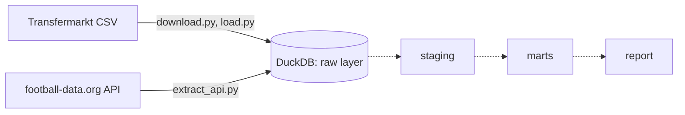

# Football Club Analyser

Currently paused (November 2026). A pipeline in Python, SQL and DuckDB that recreates the club analysis I did by hand during my scouting internship (squad age structure, minutes, foreign players, transfers), so it can run for any club or league at once.

## How it works

Both sources go straight to the raw layer in DuckDB. Next steps are planned (dotted arrows) but yet to be done.


## Done so far

* `src/download.py` downloads the [transfermarkt-datasets](https://github.com/dcaribou/transfermarkt-datasets) package and unpacks the CSVs
* `src/load.py` loads all tables into DuckDB (1.89M appearances, 89k games, 796 clubs)
* `notebooks/explore.ipynb` first look at the data in SQL
* `src/extract_api.py` downloads Premier League standings from the football-data.org REST API and saves them in the `raw.api_standings` table in DuckDB, because the Transfermarkt data ends in July 2026

## Status

Next steps when I resume:

* SQL layers: staging (cleaned tables) and marts (club metrics)
* data quality checks
* a report script: pick a league and season, get a comparison table and charts

## Notes on the data

* The transfermarkt dataset is frozen at 6 July 2026 (updates paused by its author, see the [status announcement](https://github.com/dcaribou/transfermarkt-datasets/discussions/383)), so 2025/26 is the last full season.
* Ekstraklasa is listed in the competitions and games tables, but has no records in appearances, so player level metrics (minutes, age structure) can't be calculated for Polish clubs from this source.
* There are about 21 appearances per game on average, fewer than the 26 to 28 players who usually play. Missing lineups like the Ekstraklasa ones are a likely cause. To check in the validation step.

## Run

```bash
pip install duckdb pandas matplotlib requests python-dotenv
python src/download.py
python src/load.py
# Save a free API key from football-data.org in a .env file as FOOTBALL_DATA_API_KEY=your_key
python src/extract_api.py
```
